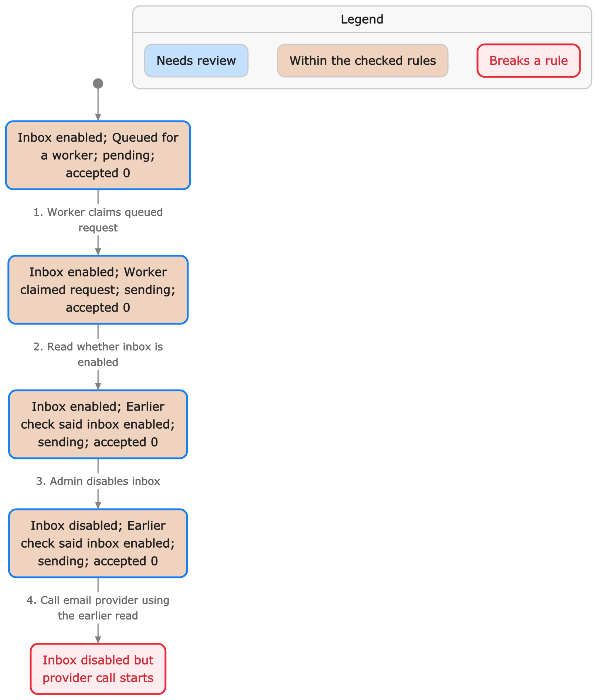
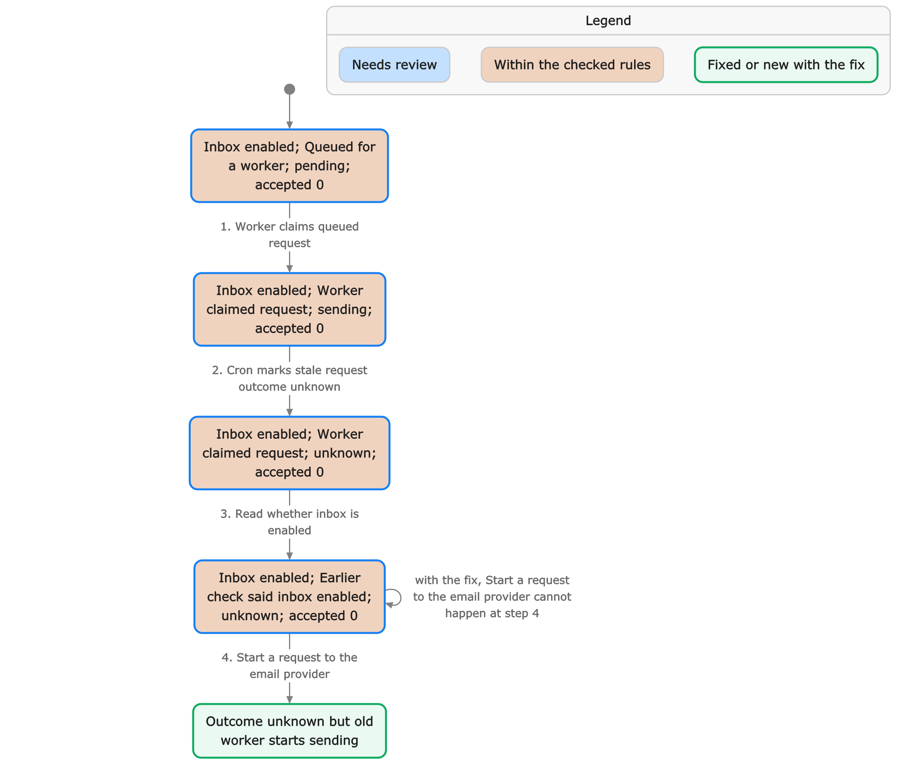
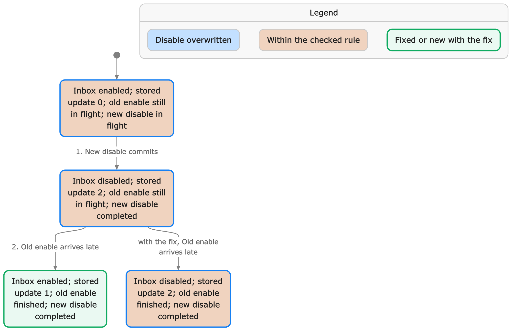
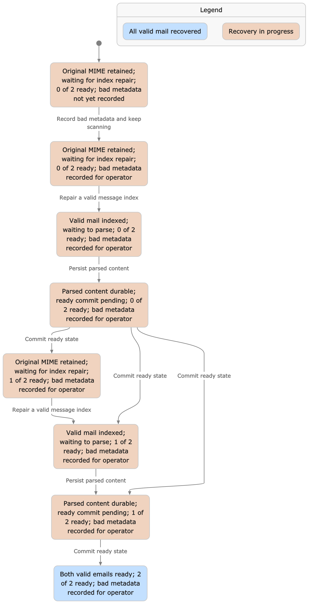

# 送受信と障害復旧の形式検証

[English](formal-verification.md) | [日本語](formal-verification.ja.md)

2026-10-25に、[pstack](https://github.com/cursor/plugins/tree/9580c23696ac8d7abed0c166f2f9918800afb819/pstack)の手順で送信停止・復旧と受信原文の索引修復を検証した。TLA+ / TLC 2.19で操作順序を検査し、実際のDurable Object・D1・R2を使ったテストで確認している。

製品コードの同期先は[`verification/product-revision.txt`](../verification/product-revision.txt)に記録する。最初の調査対象は`ed15d43123471a7de7c89be7f77f5380da136dc9`で、当時見つかった送信の競合2件は修正済み。受信の修復停止も修正した。現在の検証はすべて成功を要求し、既知の失敗を許容してCIを通す設定はない。

## 結果

| 対象・性質                                             | モデル検査                           | 実コード                                                    |
| ------------------------------------------------------ | ------------------------------------ | ----------------------------------------------------------- |
| 同じoutbox要求が2回受理されない                        | 反例なし                             | 重複ジョブでもプロバイダー呼び出し1回                       |
| 結果不明後に新しい送信試行を作らない                   | 反例なし                             | unknownにした要求を再配信しても呼び出しは増えない           |
| 無効化成功後、無効の間は新しい外部呼び出しを開始しない | 旧モデルに反例、修正モデルに反例なし | 無効化は先行処理を待ち、後続の送信を拒否                    |
| Cronのunknown化後に古い実行が送信を開始しない          | 旧モデルに反例、修正モデルに反例なし | 生きた送信を待ち、終了した処理だけを復旧                    |
| 古い有効化の書き込みが新しい無効化を巻き戻さない       | 反例なし                             | 同じSQLite状態を使う2つの実インスタンスで遅延書き込みを拒否 |
| 処理中の古い無効化が送信許可の順序を逆転しない         | 反例なし                             | 無効化が先なら送信せず、バリアが先なら古い書き込みを拒否    |
| 保存済み原文を修復・解析で失わない                     | 反例なし                             | D1・解析用R2書き込み・Queueの障害後も原文を取得可能         |
| readyは解析結果の永続化後にだけ確定する                | 反例なし                             | 解析結果保存・ready更新それぞれの失敗から復旧               |
| 壊れた原文メタデータが後続の正常メールを妨げ続けない   | 条件付きのEventuallyReadyが成立      | 実R2のページをまたいで正常な索引を修復                      |
| 修復失敗を記録する前にカーソルを進めない               | 反例なし                             | 失敗の保存ができないときは走査位置を保持                    |

通常のテストに加えて、検証専用の送信10件・受信8件が成功する。外部メール送信はスタブに置き換えており、実際のメールは送っていない。

## F1・F2: 送信停止と復旧の競合

旧実装では、送信Workerが有効状態を読んだ後に無効化が完了しても、手元の読み取り結果で外部呼び出しを開始できた。また、2分以上遅延したWorkerをCronがunknownにしても、元のWorkerが再開して初めて外部を呼べた。後者で受理結果を保存しても、DBはunknownのまま残った。

送信、管理APIの有効・無効化、Cronの古い送信の復旧を、受信箱IDで決まる同じ`InboxCoordinator`に集めた。Object内の順序制御はD1や外部APIのawaitをまたいで維持する。無効化APIは先行する送信処理が終わり、無効化を保存してから成功を返す。Cronも同じ順序に入り、実行時点の状態と時刻を再確認する。

[Cloudflareの所有権の制約](https://developers.cloudflare.com/durable-objects/platform/known-issues/#global-uniqueness)では、置き換え前のObjectが外部I/Oから復帰し、ストレージに触るまで置き換えを検出しない場合がある。そのため、送信直前にSQLiteへ同期書き込みを行う。所有権確認とプロバイダー呼び出し開始の間にはawaitを置かない。





旧モデルと修正モデルの比較は[stories.md](../verification/outbound/evidence/stories.md)。経路3・4は同じ2件が重なる経路で、追加の独立した不具合ではない。元の反例は旧コードを実D1で再現済みで、現在のテストは同じ中断点で無効化・復旧が追い越さないことを確認する。

無効化には先行I/Oを待つ時間がかかる。APIのタイムアウトを停止成功と扱わず、状態を確認する。すでに開始した通信の到着や受理を取り消せるという保証ではない。

## Object置き換え時の有効状態の保護

順序制御の実装には、D1更新がすでに進行中のままObjectが置き換わる場合もある。古いObjectが発行した有効化の書き込みが、新しいObjectの無効化より後に届いても巻き戻さないよう、SQLiteの単調増加する連番をD1の`active_version`と比較する。古い版の更新は失敗として返す。

[ActiveVersion.tla](../verification/outbound/ActiveVersion.tla)は、版1の有効化と版2の無効化がすでに発行済みという開始状態から、D1へ届く順番を検査する。版の発行とObjectの置き換え自体をこの小モデルが証明するわけではなく、その部分は実コードの再現で確認する。



この図の反例は版の比較を外した変異版で、修正後のコードで起きると報告しているものではない。

## F3: 壊れたメタデータで原文の走査が停止する

旧`repairRawIndex`は、一件でも`indexRaw`が失敗するとカーソル保存前に終了していた。同じ原文を毎回読み直すため、後ろのページにある正常な原文が索引登録されない。

修正後は、メタデータ不正、復元待ちの受信箱、索引書き込みの失敗を`raw_recovery_failures`へ保存して次へ進む。失敗記録も保存できなければカーソルを進めない。問題のある原文は残し、次の周回で再試行する。修復に成功すると失敗記録を消す。未解決の失敗は管理者ヘルスチェックで503になり、Cronは進捗を保存したうえでエラーを返す。

原文の索引修復・古い送信の復旧・受信の再投入・送信の再投入は独立に試す。一方の失敗がもう一方の再投入を止めないことも確認した。



解析用R2オブジェクトの保存とD1のready更新は別の操作として検査する。重複した解析や索引修復でreadyをpendingに戻さず、受信イベントを重複作成しないことは実コードでも確認している。

## 検証範囲と仮定

- **送信:** 一つの受信箱・一つのoutbox・実行主体2つ・最大8 claim。mutex取得、D1のclaim、有効状態の読み取り、同期fenceと送信開始、結果保存、実行停止、Object置き換えを分ける。429と明確な拒否は未受理、unknownは受理済みの場合も含む。バックオフは実行可能になる順序を抽象化し、数値や時刻同期を証明しない。公平性・送信の可用性・待ち時間は検査しない。
- **版付き更新:** 古い有効化と新しい無効化の2要求・版2つ。任意の有効化・無効化の履歴を証明していない。
- **受信:** 保存済み原文3件（正常2・メタデータ不正1）、1ページ1件、一時障害は最大2回。索引作成、失敗記録の削除、カーソル保存、キュー投入、解析結果保存、ready更新、ackを分ける。EventuallyReadyには有限で安定した原文集合、有限回の障害、有効な原文がMIME・解析結果サイズの上限内にあり、正常なCron・キュー配信・解析が実行可能なまま放置されない弱公平性を仮定する。原文保存前のSMTP配送や、不正なメタデータ・MIMEそのものの自動修復を保証しない。
- D1の各SQLと同期SQLite操作は原子的とする。D1/DOの片方だけの復元、管理SQLでの状態変更、暗号・認証、パーサーの正しさ、実環境のメール到達性、システム全体のバグ不在は証明していない。

実コードの検査は元のAPI・クラス・D1・R2・復旧処理を呼ぶ。時計の代わりにclaim時刻を古くしたり、awaitの前後を止めたりして順序を制御する。所有権喪失のテストはfenceの失敗を注入するもので、Cloudflareの実ネットワーク分断を作ってはいない。版付き更新は同じSQLite上に2つのクラス実体を作って引き継ぎを再現しており、プラットフォームの置き換えそのものの再現ではない。

解析結果の16 MiB上限はparsed保存の前に検査する。新しい永続化操作はなく、超過時は原文を残してreadyを確定しない。モデルの正常解析は上限内の入力を表し、恒久的な上限違反にEventuallyReadyは適用しない。専用の回帰テストで原文保持・解析結果なし・pending・通知なしを確認する。[セキュリティ調査](security-audit.ja.md)も参照。

OAuth対応で変更したのはHTTPの認証と受信箱への認可です。モデル化した送信、無効化、復旧、rawインデックス、解析の操作順序は変えていません。既存モデルと実コードリプレイを変更せずに再実行しています。OAuth discovery、JWT検証、受信箱の所有権、カーソルの更新継続は `test/oauth.test.ts` で別途確認しています。これは回帰テストであり、認証の形式的な証明ではありません。[認証と認可](authentication.ja.md)を参照してください。

## 複雑度削減に伴う同期

製品リビジョン `ee8c98f11baf9eb04bf3e2c37c10a7aeb372e32f` では、プロバイダー応答の分類、条件付きの結果保存（`settleSend`）、rawメタデータの検証、エスケープを含むJSONサイズ計算を小さな処理へ分けました。前回の同期 `54b677e5f77962db60e3da0ce9a88b3fafdf9cf1` から検証対象の変更をすべて照合し、モデル化した原子的な操作、状態の条件、外部awaitの境界に変更がないことを確認しました。その間のAPIの所有権・名前指定・ドメイン診断の変更も、モデル化した順序に影響しません。送信・受信・有効状態の版の検証はいずれも **in sync（同期済み）** で、この検査による新たな製品の不具合はありませんでした。

D1のclaimと結果更新の条件は同じで、所有権fenceから送信開始までにawaitは入りません。原本保持、カーソルを進める前の失敗記録、readyより前の解析結果のR2保存、キューackの順序も維持しています。モデルの性質と探索範囲は変えず、コード参照だけを更新しました。リプレイの実行件数・完了確認と図のラベル選択も、失敗の判定を変えずに関数へ分けました。送信図の旧・新マッピングは23,520通りの入力で同じラベルになります。

全モデルと実コードリプレイ16件が通り、安全策を意図的に壊す8種類の変異をモデルと実コードの両方で検出しました。別途、回帰テスト33件とセキュリティfuzzing50万ケースで、CLIのリクエスト、DNS TXTの文法、MCPエラー対応、JSONの上限、資格情報の境界を確認しています。これらの部品については、テストであり形式的な証明ではありません。

小さな探索範囲で図を再生成し、[送信](../verification/outbound/evidence/refactor/chart.png)、[受信](../verification/inbound/evidence/refactor/chart.png)、[版付き更新](../verification/outbound/evidence/refactor-active-version/chart.png)のPNGを目視確認しました。隣接するMermaid、`summary.json`、`stories.md`に検査範囲を記録しています。壊れた性質はなく、過去の不具合の図も保持しています。再生成時は、現在のモデル・`*.chart.cfg`（版付き更新は `ActiveVersion.cfg`）・マッピングをリポジトリ外へコピーし、同梱のstatechartで `from-spec MODEL --config CONFIG --map MAP --cover --png` を実行します。TLC・Javaの設定は現行のhelpに従ってください。

### 8/6への追加削減

製品リビジョン `741a80e7d576a33746c1b1b2919364104094fc2e` では、URLと本人識別の検証、キュー1件の処理、rawメタデータとページの取得、解析内容の既定値、プロバイダーの結果フィールドをさらに分けました。`ee8c98f11baf9eb04bf3e2c37c10a7aeb372e32f` 以降の検証対象をすべて照合し、モデル化した永続化の原子的な操作と条件が保たれていることを確認しました。非同期ヘルパーのPromise継続は増えますが、claim/fence/結果保存、解析結果保存/ready、失敗記録/カーソル、解析/ackの境界をまたいで操作を移していません。キューの各項目は引き続き順番に処理します。3つのモデルとも **in sync（同期済み）** で、探索範囲と性質は同じ、新しい反例はありません。

全検証と8種類のモデル・実コードの変異検査を再実行しています。実ストレージを使うキューの回帰テスト3件を追加し、成功と失敗が混在するバッチ、再試行の間隔と上限、重複配信でのイベント重複防止を確認します。ローカルのキュー結果ヘルパーは各項目の遅延を返さないため、実際の公開 `retry` メソッドへの呼び出しもspyで観測します。上記の小さな探索範囲の図も再生成して目視確認し、送信のマッピングは23,520通りで一致しました。認証とパーサーは回帰テスト・fuzzingで確認する範囲であり、形式的な証明の対象外です。

## 再実行とCI

```sh
mise install
mise exec -- bun install --frozen-lockfile
mise run verify
# 通常の検査・ビルド・秘密情報検査と合わせる場合
mise run ci
```

個別には`verify:outbound`、`verify:inbound`、`verify:attachments`、`verify:webhooks`、それぞれの`:selftest`を使う。selftestは正常系の検証もすべて含むため、CIでは対象ごとに1回実行し、両方のレポートを保存する。同時に検査できる性質は探索を共有し、まとめた検査が失敗した場合は個別に再実行してから性質ごとの結果を報告する。通常検査は成功で終了コード0、性質・assertionの失敗は1、ツールやテスト起動の失敗は2。検証専用テストの欠落やランタイム異常を成功として扱わない。計測値と維持した検査は[CIの実行時間](ci-performance.ja.md)を参照。

TLC の JVM ごとに、検証ランナーの一時領域内の専用ディレクトリを `java.io.tmpdir` として渡す。固定したツールは標準モジュールを同じファイル名で展開し、終了時に削除するため、システムの一時領域を共有すると並列検査で解析エラーになることを再現した。実際の TLC を使う回帰テストで、継承した一時領域のファイル保持と、並列実行時の展開先の分離を検査する。モデル・性質・探索範囲・失敗の扱いは変えていない。

selftestは、条件付きclaim、直列化、所有権fence、版の比較、メタデータ不正時の継続、原文保持、解析結果の永続化、失敗記録の保存を壊した一時コピーを検査する。既存の送信・受信の各変異は、モデルと実コードの両方で失敗を検出した場合だけ成功する。送信では追加で送信許可を取り除き、指定した実コードのアサーションが失敗することを要求する。対応する補完モデルはWebhookの対象で検査する。添付は後述の6種類のモデル変異と2種類の実コード変異を別に報告する。元の製品ファイルは変更しない。

GitHub Actionsでは送信・受信・添付・Webhookの4ジョブで、モデル検査・実コードの再現・変異検査を実行する。TLCのjarはSHA-256を確認し、ActionsもSHA固定。結果とログは`.verification/outbound/`・`.verification/inbound/`・`.verification/attachments/`・`.verification/webhooks/`へ出力し、CIのartifactとして14日保持する。証拠のスナップショットは各`verification/*/evidence/results.json`に保存する。

送信の再現はケースごとに別のテストisolateで実行する。テストで注入したObject内のクロージャーを残したまま同一isolateをresetすると、ローカルworkerdがクラッシュしたため分離した。製品の例外や失敗を無視する設定ではない。

## 図とコードの同期

図はpstack `/statechart`で生成し、PNGを目視確認する。送信図は旧モデルと現在のモデルを最大2 claimで比較する。受信図は一時障害0回の小さな設定で、全検査の最大2回より小さい。版付き更新の図は比較ガードを外したモデルと現在のモデルの比較。図の状態数から本検査の範囲を推定しない。

再生成は同梱のstatechartスキルの現行手順を読み、各モデル・`*.chart.cfg`・`*.map.mjs`をリポジトリ外にコピーして行う。送信の比較元は`b50dd4b`の`Outbound.tla`と`Outbound.chart.cfg`。生成した`summary.json`、`stories.md`、MermaidとPNGを対応するevidenceディレクトリへ戻す。

送信変更時は[verify-outbound-safety](../.agents/skills/verify-outbound-safety/SKILL.md)、受信変更時は[verify-inbound-recovery](../.agents/skills/verify-inbound-recovery/SKILL.md)に従う。コード変更後の同期が不明ならpstack `/maintain-formal-verification-skill`で照合する。今回は、旧コードの失敗は実際の不具合、mutexと所有権・版を加えたモデル更新はコードの形の変更に対応したものと判断した。性質を弱めて反例を消す変更はしていない。

## 送信添付（2026-10-26）

製品リビジョン `cf0404a` は非公開の添付アップロードと、最終所有権検査前の内容検証を追加しています。`Outbound.tla` に準備成功・失敗の独立したactionを追加し、既存の上限と5つの安全性条件を維持しました。既存8本の実コード再現と4組のモデル・実コードmutation検査が通過しています。追加の実Durable Object・D1・R2テストでは、添付読み込みを停止し、コーディネーター交代・無効化・結果不明への回復後に古い処理を再開します。所有権検査で停止し、プロバイダー呼び出し0回と `unknown` の維持を確認しています。

[`Attachments.tla`](../verification/attachments/Attachments.tla) は4つの有限シナリオを検証します。

| シナリオ                 | 具体状態数 | 検査する性質                                                                         |
| ------------------------ | ---------: | ------------------------------------------------------------------------------------ |
| 同時アップロード         |          9 | 条件付き書き込みは既存アップロードを上書きしない                                     |
| 受信箱の分離             |         24 | 別受信箱の参照を受理せず、受理した要求は保存済みキーの内容と一致する                 |
| 冪等性の競合             |         45 | 異なる内容を同じキーで両方受理しない                                                 |
| 準備中のスナップショット |         28 | 欠損・取得不能・改変・差し替えを送信せず、検証済みメモリ上の内容はキューのIDに紐づく |

上限は受信箱2個・不変ファイル2個・同時要求2本・冪等性キー1個・保存障害1回です。内容・メタデータのハッシュは衝突しないものと理想化し、D1一意制約とR2条件付き書き込みを原子的操作、GETを一貫したオブジェクトのスナップショットとして扱います。プロバイダーの不確実な結果と所有権は送信モデルで別に検証します。有限範囲のモデル検査であり、暗号・MIMEやパーサー・マルウェア・配達・プログラム全体を証明するものではありません。

条件付きput・受信箱紐づけ・冪等性ハッシュ一致・内容検証・取得可能性・スナップショット利用を外す6種類のモデルmutationは、すべて想定した条件の反例になります。実コードではAPI受信箱認可またはSHA-256検証を外した2種類を一時コピーで実行し、対応するassertionが失敗しました。残り4種類はモデルのみのmutationです。通常の実ストレージテストでは、変更不可の再利用・内容変更のキー競合・欠損と改変・接続前の保存障害再試行・スレッド返信・上限・最大サイズのリモートMCP・コーディネーター交代を検査します。

pstackの状態図は4シナリオすべてを描画して目視確認しました。[アップロード](../verification/attachments/evidence/upload/chart.png)・[分離](../verification/attachments/evidence/isolation/chart.png)・[キー競合](../verification/attachments/evidence/queue/chart.png)・[準備](../verification/attachments/evidence/prepare/chart.png)です。Mermaid・説明・設定・概要・ソースハッシュ・mutation結果は[証跡](../verification/attachments/evidence/)に保存しています。更新した送信の図は[添付準備](../verification/outbound/evidence/attachments/)にあります。

```sh
mise run verify:attachments
mise run verify:attachments:selftest
# 全モデル・mutation・通常チェック
mise run ci
```

CIはformal matrixの `attachments` を実行して生ログとレポートを保存します。状態図の再生成は、一時ディレクトリに `Attachments.tla`・対象の証跡の `Attachments.cfg`・対応する `Upload.map.mjs` / `Queue.map.mjs` / `Attachments.map.mjs` をコピーします。固定ツールを用意したcheckoutから `node .agents/skills/statechart/scripts/statechart.mjs from-spec /scratch/Attachments.tla --map /scratch/Attachments.map.mjs --cover --png` を実行し、リポジトリ外に生成した各PNGを確認します。

## 遅延した書き込みと送信許可

古いコーディネーターが版を採番してD1の無効化書き込みを開始し、Objectの引き継ぎ後に新しいコーディネーターが有効状態を読む場合があります。その後、古い書き込みが完了して無効化成功を返しても、新しいコーディネーターの最後の所有権fenceは成功します。所有権だけでは、古い有効状態を使った送信を防げません。

送信では添付の準備後に `outboundDispatchBarrier` を実行し、受信箱が有効な場合だけ `active_version` を原子的に進めます。無効化が先に確定した場合は送信許可が失敗し、プロバイダーへの要求を開始しません。送信許可が先に確定した場合は古い版の無効化が拒否され、成功を返せません。このD1書き込みをawaitした後も、プロバイダー呼び出し直前に同期的な所有権fenceを実行します。

[`DispatchBarrier.tla`](../verification/webhooks/DispatchBarrier.tla) の `EmailOnly = TRUE` が、既存の送信状態機械を補完します。古い実行主体による処理中の書き込み、Objectの引き継ぎ、準備、バリアの予約と確定、再度の引き継ぎ、新しい実行主体による無効化、最後のfence、送信開始を分けています。探索範囲は受信箱1つ・コーディネーター3世代・古い無効化の書き込み1つ・その後の実行主体による変更1つです。`NoObsoleteDispatch` は、古い準備結果から送信を開始しないことを検査します。D1バリアまたは最後のfenceを取り除くと反例が生じ、`verify:webhooks:selftest` が両変異を検査します。

追加した送信の2リプレイは、同じ実SQLite・D1を使うコーディネーターの実クラスで、古い無効化が新しい実行主体の有効状態の読み取り後に確定する順序と、新しいバリアが古い無効化より先に確定する順序を検査します。別々のisolateと制御したリクエストコンテキストで引き継ぎを模擬しており、Cloudflareの実際の置き換えを強制してはいません。`verify:outbound:selftest` は実コードの送信許可ガードも取り除き、前者のリプレイのアサーションが失敗することを要求します。この実コードのみの変異は、既存の4組のモデル・コード変異とは別に報告します。最後のfenceのリプレイは、送信許可のための予約を成功させてから、最後のfenceで所有権喪失を注入します。

同じ有限モデルの `EmailOnly = FALSE` はWebhook設定の置き換えも検査します。メールのシナリオは異なる39状態、Webhookは77状態を探索します。Webhookの対象には、版付き設定、永続的なイベント・配信ID、条件付きclaimと結果保存、自動生成または指定した冪等キーの保持も含みます。正常系7シナリオはすべて成功し、モデル変異12種類は指定した性質の違反を検出し、別に報告する実コード変異5種類はアサーションが失敗しました。[モデルの範囲とコードとの対応](../verification/webhooks/README.ja.md)も参照してください。暗号、UUIDの耐衝突性、宛先originの制限、HTTPの挙動、経過時間、メール到達性、プログラム全体の正しさは、これらの有限モデルの対象外です。具体的な境界は実コードのテストで確認します。

## 受信メールの標準転送（2026-10-26）

製品リビジョン`0f2689da7e4fc9ccdad75bd64e761c84ff645d37`で全体・個別の転送設定とSMTP受信中の標準転送を追加しました。前の同期点から確認し、送信claim・コーディネーターのfence・添付の準備には変更がありません。受信は原文先行を維持し、条件付きR2 PUTで受信時の転送判断を固定します。メンテナンスには独立した転送の注意状態への更新を追加しました。

既存の保証を弱めず、検証を**更新**しました。D1喪失を再現する2ケースは、追加された転送履歴を残したまま受信索引だけを削除したため外部キー制約で失敗しました。両方のD1状態を失うようフィクスチャを修正しています。この失敗はハーネスのドリフトです。既存の復旧モデルは同期を維持しています。別の[Forwarding.tla](../verification/inbound/Forwarding.tla)で、同じMIME原文に対する2つのSMTPハンドラと、転送なし・信頼済み・許可外の3分類をモデル化しました。設定取得・条件付き原文保存・索引・pendingの読み取り・claim・標準転送・条件付き完了・中断・復旧を分離しています。

| 転送の性質                       | 製品の操作                                    | 根拠                                                                            |
| -------------------------------- | --------------------------------------------- | ------------------------------------------------------------------------------- |
| 標準転送より先に原文を保存       | `receive`・`indexRaw`・`forwardReceived`      | 実R2の保存・読み取り障害テストと`RawBeforeForward`                              |
| 受信時の転送判断を変更しない     | 条件付きR2 PUT・`indexForwarding`             | 最初の受信を止め、全体設定変更と別の受信を競合させるケースと`SnapshotPreserved` |
| 信頼する宛先だけに転送           | `forwardingPlan`・`pendingTarget`・許可リスト | 許可撤回・ループのテストと`TrustedDestination`                                  |
| 同じ原文の転送呼び出しは最大1回  | 条件付きpending→sending claim                 | SMTP同時受信と`AtMostOneForward`                                                |
| 結果不明から2回目をclaimできない | 条件付き完了・`recoverForwarding`             | 遅延した完了と滞留復旧のケース、`NoBlindRetry`                                  |

`mise run verify:inbound:selftest`で復旧・転送モデル、24件の実コードケース（復旧8件＋転送16件）、8組のモデル・ソース変異を確認します。追加した4組では、条件付き原文PUT・転送claim・不明結果の復旧・宛先許可のガードを外します。モデルの対応する不変条件と、実コードの指定したアサーションでそれぞれ検出できました。ガード付きの製品は成功し、この範囲で現在の製品の反例は見つかりませんでした。

[変異の証拠](../verification/inbound/evidence/forwarding/)には番号付きPNG・Mermaid・手順・設定・集計を保存しました。[受信判断の上書き](../verification/inbound/evidence/forwarding/snapshot/bug-1.png)、[重複claim](../verification/inbound/evidence/forwarding/claim/bug-1.png)、[不明結果の再試行](../verification/inbound/evidence/forwarding/retry/bug-1.png)、[許可外宛先](../verification/inbound/evidence/forwarding/policy/bug-1.png)です。生成した図はすべてレンダリングして目視しました。緑は意図的に壊したモデルと比べて現在のガードが防ぐ経路であり、製品に残した脆弱性ではありません。図は読みやすい範囲に絞りますが、自動TLC検証は境界内の状態空間全体を探索します。

リポジトリから、claimの比較図を一時領域に再生成できます。

```sh
chart_dir="$(mktemp -d)"
mkdir -p "$chart_dir/unsafe" "$chart_dir/guarded"
cp verification/inbound/Forwarding.tla verification/inbound/Forwarding.map.mjs "$chart_dir/unsafe/"
cp verification/inbound/evidence/forwarding/claim/Forwarding.cfg "$chart_dir/unsafe/"
cp verification/inbound/Forwarding.tla verification/inbound/Forwarding.cfg "$chart_dir/guarded/"
mise exec -- node .agents/skills/statechart/scripts/statechart.mjs from-spec \
  "$chart_dir/unsafe/Forwarding.tla" --fixed "$chart_dir/guarded/Forwarding.tla" \
  --cover --png --out "$chart_dir/output"
```

`snapshot`・`retry`・`policy`の設定に置き換えると他の変異を確認できます。PNGと同じ場所の`stories.md`と`summary.json`には、隠れた手順や概要図で省いた経路を記載します。既存の受信復旧図も再生成して目視しました。

モデルは条件付きR2・D1書き込みの原子性、D1を巻き戻さないこと、標準転送の契約を前提にします。宛先の分類には、以前許可した宛先の撤回も抽象化しています。受信箱の有効状態・ループ防止・管理者認可は実コードで確認し、この転送モデルでは証明しません。有限の安全性を対象とし、転送の必達・任意の同時実行・暗号・Cloudflareの実際の検証・SMTPやDMARC・相手への配信・外部転送ループの不存在は証明しません。無効化前に取得済みのclaimは後で完了でき、送信の直列化された無効化契約とは異なります。許可リスト更新で古いWorker実行を取り消すこともできません。[転送の運用](forwarding.ja.md)に従い、許可された実メールで別途確認してください。
